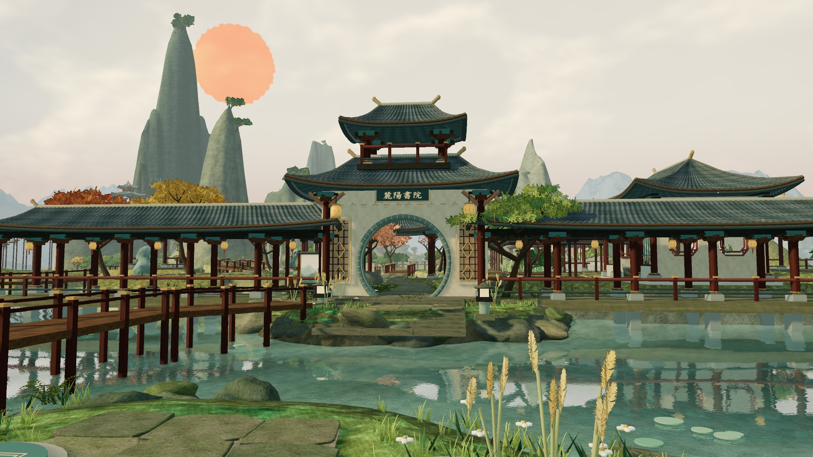

# 麓阳书院 · 合璧入画

**[进入书院，在线游玩](https://xunguangzlj-cloud.github.io/luyang-academy/)**

带着同伴走上入院石径，找到朱印，合力开启通往书院的桥。解开入口机关后，可以沿水廊游园，走访画室，或走进一幅可以跳跃穿行的山水画。

这是以《原神》空之神殿·麓阳书院为场景参考的非官方 Three.js 网页游戏。一人控制当前角色，可以随时换人或指挥同伴。山岭、庭园和房间依据实机画面重建，双印机关与画中跳台为本作改编。

## 开始游玩

手机和电脑都可以打开上方的试玩链接。在线版先显示进度，再并行加载角色和场景，首次传输约 7.3 MB。手机横屏时可以用左侧摇杆移动、右侧按钮跳跃或互动。电脑操作见下表。

**[下载离线单文件](https://github.com/xunguangzlj-cloud/luyang-academy/raw/refs/heads/main/offline.html)**。将 `offline.html` 保存到电脑后，双击即可游玩。文件内含引擎、角色、动画、完整地图与材质。

| 操作 | 按键 |
| --- | --- |
| 移动、快跑、跳跃 | WASD、Shift、空格 |
| 旋转镜头、缩放 | 拖动鼠标、滚轮 |
| 拾放、操作机关 | F、E |
| 蓄力投掷 | 按住鼠标左键，松开投出 |
| 滚动、切换角色、指挥同伴 | 按住 Ctrl 或 Q、Alt、C |
| 打开舆图、暂停并查看完整操作 | J、Esc |

## 实机截图

两张图均截自在线试玩，原图为 1920 × 1080。点击图片可打开原尺寸文件。

## 参考作品与致谢

- 感谢米哈游《原神》团队创作空之神殿·麓阳书院。书院的山水布局、庭园与建筑是本作的场景参考。[《原神》官网](https://ys.mihoyo.com/)
- 感谢 Hazelight Studios 的《双人成行》，两位角色配合解开环境机关的玩法受其启发。[It Takes Two](https://www.hazelight.se/games/it-takes-two/)
- 特别感谢大肥鱼的《暖光玩具房 · V30 网页试玩》（双人成行·大肥鱼版）。本作直接沿用试玩的人物模型、材质、骨架和动作，并参照其移动、滚动、拿放和投掷操作。网页中的两名角色共用经减面的模型，各有独立骨架。[大肥鱼版试玩](https://v25.dafeiyugame.site/)
- 感谢实机录像作者留下可逐帧对照的入院路线、室内陈设和秋园视角。[双刀纸袋布的《克苟初探麓阳书院》](https://www.bilibili.com/video/BV1oQD7BMEBe/?t=118) · [爱吃酥饼-露露的山门与北峰实拍](https://www.bilibili.com/video/BV1u8DJBwEGR/?t=20) · [百莫大三角的开图实况](https://www.bilibili.com/video/BV1MgdKBKEc4/?p=4&t=379) · [刻求Destination 的美学鉴赏](https://www.bilibili.com/video/BV1roDWBFEuE/?t=25)
- 感谢胡桃不肆桃、StarrZ、main_tan._.hong 分享书院摄影，也感谢地图与攻略编辑者整理全境地点。它们帮助校对山脊剪影、建筑间距和庭园构图。[胡桃不肆桃](https://www.miyoushe.com/ys/article/74464761) · [StarrZ](https://www.hoyolab.com/article/44822181) · [main_tan._.hong](https://www.hoyolab.com/article/44916993) · [空之神殿地图](https://wiki.biligame.com/ys/空之神殿地图) · [Game8 攻略](https://game8.jp/genshin/778315)
- 感谢 three.js 作者与贡献者。单文件内保留引擎的 MIT 许可声明。第三方角色、动画及原作相关内容的权利归各自权利人所有。[three.js](https://github.com/mrdoob/three.js)
